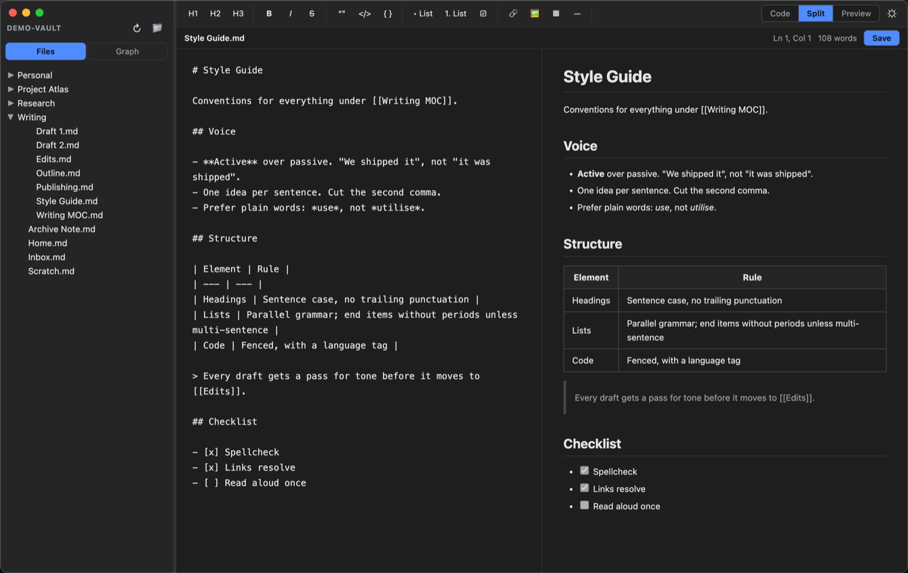
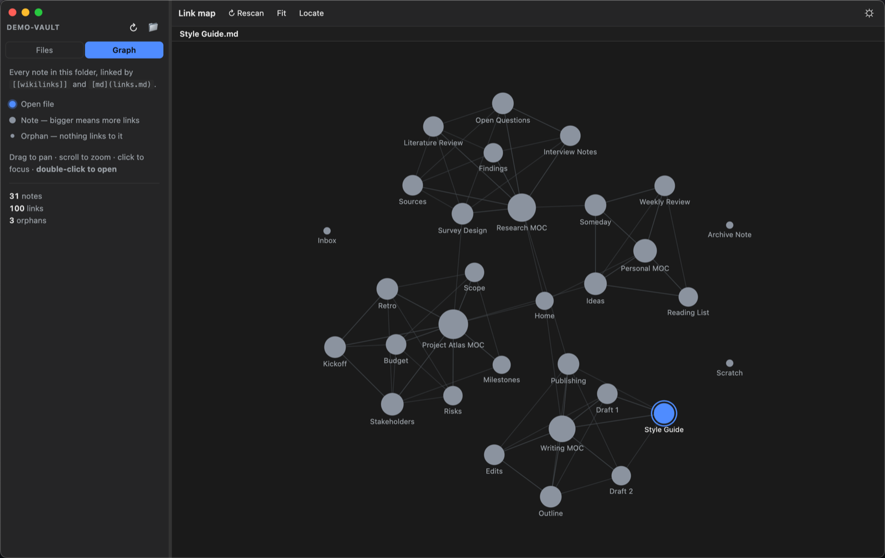

# Markpad

A lightweight, **local-first** Markdown editor built with [Electron](https://www.electronjs.org/).
Write Markdown without memorising the syntax, see a live preview, and navigate your
notes through an Obsidian-style link map.



---

## What it does

Markpad opens a **folder** of `.md` files and gives you three tools over it: an editor
with a button for every Markdown element, a live preview, and a graph that shows how
the files link to each other.

No cloud, no account, no database — your files stay plain `.md` on disk.

## Features

### ✍️ Editor with a toolbar

Every Markdown element has a button, so you never have to remember the syntax:

| Group | Buttons |
| --- | --- |
| Headings | `H1` `H2` `H3` |
| Emphasis | **Bold** · *Italic* · ~~Strikethrough~~ |
| Blocks | Blockquote · inline code · code block |
| Lists | Bulleted · numbered · task list (`- [ ]`) |
| Inserts | Link · image · table · horizontal rule |

Buttons act on the **current selection**. Inline styles (bold, italic, strikethrough,
inline code) and line prefixes (headings, blockquote, lists, task list) work as a
toggle — select text that is already bold and the button un-bolds it; apply a list to
several selected lines and each line gets the prefix. Code block, link, image, table and
horizontal rule insert a snippet, with the placeholder URL pre-selected so you can type
over it. `Tab` inserts two spaces instead of moving focus away.

### 👁️ Three views

`Code` (source only) · `Split` (source + preview side by side) · `Preview` (rendered
output only). Switch with the buttons or `Cmd/Ctrl+1 / 2 / 3`.

The preview uses GitHub-flavored Markdown ([`marked`](https://marked.js.org/)) and the
HTML is run through [DOMPurify](https://github.com/cure53/DOMPurify) before it is shown.
It updates as you type.

### 📁 File browser

A tree view of the folder on the left — nested sub-folders that expand on click, lazy
loading, the open file highlighted. Folders come first, then files in natural order
(`note2` before `note10`). Markdown files (`.md`, `.markdown`, `.mdown`, `.mkd`) are
visually distinct from plain text (`.txt`, `.text`) and everything else. Hidden files
(`.dotfiles`) are skipped. Drag the divider to resize the sidebar.

Opening a single file (`Cmd/Ctrl+O`, the command line or a file association) while no
folder is open also opens the file's parent folder.

### 🕸️ Link map



The **Graph** button in the sidebar scans the folder and draws every note as a node,
with edges for the links between them. It recognises:

| Form | Examples |
| --- | --- |
| **Wikilinks** | `[[Note]]` · `[[Note\|alias]]` · `[[Note#heading]]` · `[[folder/Note]]` |
| **Markdown links** | `[text](note.md)` · `[text](../folder/note.md)` · percent-encoded names |

It correctly ignores external URLs, `mailto:`, images and other non-Markdown files,
bare anchors (`#section`), and anything inside inline or fenced code. Duplicate links
to the same target count once, and self-links are dropped.

Links are resolved case-insensitively, first relative to the linking file, then
relative to the folder root. A bare wikilink like `[[Note]]` matches a note of that
name anywhere in the folder (the first match wins if several share a name). A link
that looks like a note but matches no file counts as a **broken link**.

Hidden folders and `node_modules`, `dist`, `distro`, `out`, `build`, `vendor` and
`target` are skipped, as are symlinks. To stay responsive on large folders the scan
stops at 4,000 notes (the sidebar says when it was truncated), and files over 1 MB are
mapped as nodes but not parsed for links.

**Controls:** drag to pan (or drag a node to rearrange) · scroll to zoom · click to
focus a node and its neighbours · **double-click to open** the file. In the toolbar:
`Rescan`, `Fit` (zoom to fit), `Locate` (centre on the open file).

Node size reflects the number of links · the open file has a blue ring · orphans (no
links at all) appear as small isolated dots. The sidebar shows totals for notes, links,
orphans and broken links.

The graph is written from scratch on a `<canvas>` — a force-directed layout with a
spatial grid, **no external library**. The layout is deterministic, so the same folder
always produces the same map.

### 🌗 Light / Dark theme

Toggle with the button in the top-right or `Cmd/Ctrl+T`. The choice is remembered and
applies to the graph too.

### Smaller things

- **Session restore** — reopens the last folder, file, theme, view, sidebar tab
  (Files / Graph) and sidebar width.
- **File associations** — double-clicking a `.md` file in Finder / your file manager
  opens Markpad (after installing a package). Only one instance runs: opening another
  file while Markpad is up sends it to the existing window.
- **Status bar** — file name, unsaved-changes indicator, cursor position, word count,
  and a Save button.
- A confirmation before opening another file or starting a new one would discard
  unsaved changes.

## Running from source

Requires [Node.js](https://nodejs.org/) 18+.

```bash
git clone https://github.com/cimaz/markpad.git
cd markpad
npm install
npm start
```

Open a specific file: `npm start -- path/to/file.md`

## Packaging

```bash
npm run dist          # macOS + Linux
npm run dist:mac      # macOS  — .dmg + .zip (arm64 & x64)
npm run dist:linux    # Linux  — .deb + AppImage (x64 & arm64)
npm run pack          # unpacked build, no installer (quick check)
```

Packages are written to `distro/`. The macOS targets have to be built on a Mac (the
post-pack step signs the app with `codesign`), so on Linux use `npm run dist:linux`
rather than `npm run dist`. The icon is generated automatically from
[`build/icon.svg`](build/icon.svg) — rendered by Electron itself, so no ImageMagick or
sharp is needed. Configuration: [`electron-builder.yml`](electron-builder.yml).

### Linux releases (GitHub Actions)

Pushing a version tag builds the Linux packages on GitHub and attaches them to a new
release ([`.github/workflows/release-linux.yml`](.github/workflows/release-linux.yml)):

```bash
npm version 1.1.0          # bumps package.json and tags v1.1.0
git push --follow-tags
```

The workflow fails if the tag doesn't match the version in `package.json`. It can also
be started by hand from the **Actions** tab; that builds the packages as a downloadable
workflow artifact without creating a release.

### Installing on Linux

**`.deb`** (Debian, Ubuntu, Mint…):

```bash
sudo apt install ./markpad_1.0.0_amd64.deb
```

Installs to `/opt/Markpad` with a desktop entry, hicolor icons and a `.md` file association.

**AppImage** (any distribution) — no install needed:

```bash
chmod +x Markpad-1.0.0-x86_64.AppImage
./Markpad-1.0.0-x86_64.AppImage
```

AppImages need FUSE 2; on Ubuntu 22.04+ that's `sudo apt install libfuse2`
(`libfuse2t64` on 24.04).

### Installing on macOS

There is **no paid Apple Developer account**, so the app is **ad-hoc signed but not
notarized**. It runs fine on both Apple Silicon and Intel, but macOS Gatekeeper
quarantines anything downloaded from an unidentified developer, so you clear that flag
**once**. Pick whichever you prefer:

> **Note:** no GitHub release has been published yet, and the cask in
> [`Casks/markpad.rb`](Casks/markpad.rb) still has placeholder checksums. Until the first
> release is out, build the `.dmg` yourself with `npm run dist:mac`.

**Homebrew (recommended)** — the `--no-quarantine` flag skips the Gatekeeper prompt entirely:

```bash
brew tap cimaz/markpad https://github.com/cimaz/markpad
brew install --cask --no-quarantine markpad
```

**Manual** — open the `.dmg`, drag Markpad to Applications, then either:

- right-click Markpad in Applications → **Open** → **Open** (only needed the first time), or
- ```bash
  xattr -dr com.apple.quarantine /Applications/Markpad.app
  ```

Building a properly signed + notarized app would require the $99/year Apple Developer
Program; the `mac:` block in [`electron-builder.yml`](electron-builder.yml) has notes on
what to change if that ever happens.

#### Publishing a macOS release

```bash
npm run dist:mac                       # builds the dmgs + zips
npm run cask:sha                       # writes version + SHA-256 into Casks/markpad.rb
# create a GitHub release tagged v<version>, upload the 2 dmgs, commit the cask
```

## Keyboard shortcuts

| Keys | Action |
| --- | --- |
| `Cmd/Ctrl` + `N` | New file |
| `Cmd/Ctrl` + `O` | Open file |
| `Cmd/Ctrl` + `Shift` + `O` | Open folder |
| `Cmd/Ctrl` + `S` | Save |
| `Cmd/Ctrl` + `Shift` + `S` | Save as… |
| `Cmd/Ctrl` + `B` / `I` / `E` / `K` | Bold / Italic / Inline code / Link |
| `Cmd/Ctrl` + `1` / `2` / `3` | Code / Split / Preview |
| `Cmd/Ctrl` + `T` | Toggle light / dark |
| `Cmd/Ctrl` + `\` | Show / hide sidebar |
| `Cmd/Ctrl` + `0` / `+` / `-` | Reset / increase / decrease zoom |
| `Tab` | Insert two spaces |

## How it's built

| File | Role |
| --- | --- |
| [`main.js`](main.js) | Electron main process — window, native menu, filesystem IPC, link parsing (`graph:build`) |
| [`preload.js`](preload.js) | Safe bridge (`contextBridge`) + Markdown rendering with `marked` |
| [`src/index.html`](src/index.html) | UI structure |
| [`src/styles.css`](src/styles.css) | Themes (CSS variables) + preview & graph styles |
| [`src/renderer.js`](src/renderer.js) | UI logic — file tree, editor, toolbar, preview, splitter, graph wiring |
| [`src/graph.js`](src/graph.js) | Force-directed link graph on a canvas, no dependencies |
| [`scripts/vendor.js`](scripts/vendor.js) | `postinstall` — copies DOMPurify into `src/vendor/` |
| [`scripts/make-icon.js`](scripts/make-icon.js) | `npm run icon` — renders `build/icon.svg` to PNGs with Electron |
| [`scripts/after-pack.js`](scripts/after-pack.js) | electron-builder hook — ad-hoc signs the macOS app |
| [`scripts/cask-sha.js`](scripts/cask-sha.js) | `npm run cask:sha` — writes version + DMG checksums into the cask |
| [`Casks/markpad.rb`](Casks/markpad.rb) | Homebrew cask (the repo doubles as its own tap) |

**Security:** `contextIsolation: true`, `nodeIntegration: false`, a strict
Content-Security-Policy, and preview HTML always passes through DOMPurify. The renderer
has no direct filesystem or Node access — file operations and link parsing run in the
main process and are reached only through the small API that `preload.js` exposes
(open/save dialogs, read a directory, read/write a file, build the graph).

Runtime dependencies: only [`marked`](https://marked.js.org/).
[DOMPurify](https://github.com/cure53/DOMPurify) is copied into `src/vendor/` during
`npm install` so it loads under the CSP.

## Known limitations

- **Images with relative paths don't show in the preview.** They resolve against the
  app's own folder rather than the note's, so `` appears broken. Images
  from `http(s)://` URLs and `data:` URIs work.
- **Clicking a link in the preview** loads it inside the app window instead of your
  browser.
- **Closing the window with unsaved changes** is blocked silently, with no prompt. Save
  (or undo the changes) first.
- Files are read and written as UTF-8.

## License

[MIT](LICENSE)
